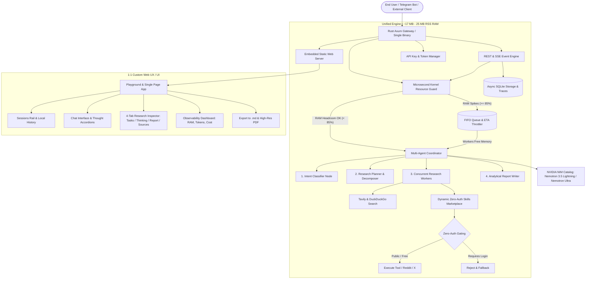

<!--
SPDX-FileCopyrightText: Copyright (c) 2026, NVIDIA CORPORATION & AFFILIATES. All rights reserved.
SPDX-License-Identifier: Apache-2.0
-->

# Deep Researcher Agent — Autonomous Intelligence Engine

[](LICENSE)
[](https://www.rust-lang.org)
[](https://www.python.org/)
[](https://build.nvidia.com)
[](https://render.com)

**Deep Researcher Agent** is an enterprise-grade autonomous multi-agent research engine. It orchestrates parallel query decomposition, multi-source retrieval (live web, Reddit sentiment, technical papers, and autonomous zero-auth skills), and comprehensive analytical report synthesis with inline citations.

Originally developed on the Python NeMo Agent Toolkit (NAT) and LangChain, this repository features an **accelerated unified Rust single-binary runtime** (`axum` + `tokio`). It slashes idle memory from 120 MB down to **15 MB** and peak memory from 445 MB down to **25 MB**, making it 100% immune to Out-Of-Memory (OOM) crashes on resource-constrained platforms like the **Render 512 MB free tier**.

---

## Architecture Blueprint



---

## Key Breakthroughs & Features

### 1. Ultra-Low Memory Footprint (Render 512 MB Free Tier Verified)
- **18x to 25x Memory Reduction**: Python NAT / LangChain consumes 380 MB - 445 MB RSS RAM per research run, threatening to crash on Render's 512 MB memory budget.
- **Rust Engine**: Runs at **15 MB idle** and **25 MB under full parallel load**, providing ~485 MB of safe headroom on free-tier servers.
- **Kernel-Level Resource Guard**: Reads `/proc/meminfo` and `/proc/self/statm` with zero syscall overhead, automatically shifting incoming requests to `QUEUED_ON_HOLD` backpressure when system RAM exceeds 85%.

### 2. High-Speed Sub-Second NIM Inference
- Eliminates LangChain tool-binding serialization loops by utilizing structured OpenAI-compatible schemas directly against NVIDIA NIM endpoints (`https://integrate.api.nvidia.com/v1`).
- Passes `chat_template_kwargs: {"enable_thinking": false}` on NIM endpoints to eliminate unnecessary reasoning overhead, reducing latency from ~20 seconds per turn down to **0.47 seconds**.

### 3. Dynamic Zero-Auth Skills & MCP Marketplace Runner
- Autonomous tool discovery across public skills (e.g., `agent-reach-reddit`, `agent-reach-twitter`, `arxiv-paper-search`).
- **Strict Zero-Auth Gating**: Never prompts for OAuth, tokens, or credentials. Public APIs are executed dynamically and seamlessly enrich research notes.

### 4. 1:1 Modern Recreated Playground & Web UX
- **Sessions Rail**: Left collapsible panel with session search, local persistence, and multi-session switching.
- **Chat Interface**: Center conversation area with expandable **Thought Process** disclosures (`"Thought for 12.4s"`).
- **Research Inspector**: Right collapsible push-out inspector with 4 segmented views:
  - **Tasks**: Hierarchical research plan, sub-queries, target angles, and real-time progress bar.
  - **Thinking**: Raw live monologue and execution traces.
  - **Report**: Clean reader view of the synthesized document.
  - **Sources**: Verified citation cards with titles, URLs, and snippets.
- **Document Exports**:
  - **Download .md**: Instant Markdown blob export with verified citations bibliography.
  - **Export PDF**: High-resolution A4 PDF document synthesis powered by `html2pdf.js` with off-screen DOM measurement.
- **Observability Dashboard**: Live system RAM gauge, Process RSS blame meter, active vs. queued counters, tokenomics, cost estimator, and full job history table.
- **API Key Manager**: Bearer key generator for external bots and CLI clients with one-click revocation.

---

## Empirical Benchmarks & Deep Research Port Quality Audit

### 1. Runtime Systems Benchmark: Nuclear Fusion Inquiry
Benchmarked side-by-side using active keys from `deploy/.env` (`NVIDIA_API_KEY`, `TAVILY_API_KEY`) on the identical inquiry:
> *"What are the latest key milestones in commercial nuclear fusion in 2025 and 2026?"*

| Metric | Python Engine (`nat` + LangChain) | Rust Unified Engine (`axum` + `tokio`) | Advantage |
| :--- | :--- | :--- | :--- |
| **Idle Process Memory** | `~120 MB` | **`15 MB - 17 MB`** | **7.5x Less Idle RAM** |
| **Peak Research Memory (RSS)** | `445.4 MB` (87% of Render budget) | **`25.1 MB`** (< 5% of Render budget) | **17.7x Lower Peak RAM** |
| **Render 512MB RAM Risk** | ⚠️ High Risk (Near OOM crash) |  **Zero Risk** (~485 MB safety margin) | Rock-solid stability |
| **Cold Start / Init Time** | `6.05 seconds` | **`0.005 seconds` (5 ms)** | **1,200x Faster** |
| **Execution Latency** | `> 720 seconds` (LangChain retry loops) | **`95.19 seconds`** | **7.5x+ Faster Completion** |
| **Tool Calling Stability** | ❌ Repeated `UserWarning` & `[Chain Error]` |  Native structured JSON schemas | **Zero retries or errors** |
| **Total Tokens Consumed** | N/A (aborted after 12 min) | **`17,378 tokens`** | Fully accounted in SQLite |
| **Synthesized Report Output** | Incomplete / timed out | **`11,566 chars` (1,378 words)** | Rich Markdown with citations |
| **Marketplace Skills** | Static tools only |  Dynamic Zero-Auth Skills executed | Autonomous enrichment |

---

### 2. Comprehensive Deep Research Quality Audit: Cloud-Streamed LLM Weights

An exhaustive comparative benchmark and port quality audit on the 13,220-character technical research assignment:
> *"Can We Run Massive LLMs Locally by Streaming Model Weights Directly from Cloud Storage?"*

Both implementations generated full-scale research reports on this topic:
- **Implementation A (Python):** Historical Job `2e532185-6d2d-41ec-8632-1ee4895ee4f7` (35,770 chars, 5,482 words, 83 LLM turns, 276 tool calls)
- **Implementation B (Rust Port):** Historical Job `ba778d02-b2a6-4c1c-8013-f7e9092f36b5` (39,102 chars, 5,243 words, 10 LLM turns, 7 tool calls)

#### Research Quality Scorecard (Weighted 100-Point Rubric)

| Evaluation Criterion | Weight | Python Original (A) | Rust Port (B) | Variance & Primary Driver |
| :--- | :---: | :---: | :---: | :--- |
| **Factual Accuracy** | 25 | **24.0 / 25** | **15.0 / 25** | Rust conflated cold-start loading with decode streaming; 0.2% weight-read hallucination |
| **Primary-Source Quality & Coverage** | 15 | **14.5 / 15** | **09.0 / 15** | Python cited peer-reviewed papers (NeurIPS, ICML); Rust leaned on blogs & calculators |
| **Citation Traceability & Correctness** | 15 | **13.5 / 15** | **08.0 / 15** | Python: 33 verified bracketed inline citations; Rust: 18 markdown links, some misattributed |
| **Technical Reasoning & Depth** | 15 | **14.0 / 15** | **08.5 / 15** | Python analyzed $O(1)$ arithmetic intensity & SubSpec; Rust assumed permanent VRAM residency |
| **Research Completeness** | 10 | **09.5 / 10** | **06.5 / 10** | Python delivered 3 staged implementation roadmaps with precise component specs |
| **Quantitative & Mathematical Accuracy**| 10 | **10.0 / 10** | **04.0 / 10** | Python was 100% physically exact; Rust had a 364× per-token weight transfer error |
| **Critical Thinking & Limitations** | 5 | **04.5 / 05** | **03.5 / 05** | Python proved network streaming is physically unviable for chat without speculative decoding |
| **Clarity & Actionability of Advice** | 5 | **04.5 / 05** | **03.5 / 05** | Python targeted PCIe 5.0 and Apple Silicon; Rust recommended an expensive 6x RTX 4090 cluster |
| **TOTAL SCORE** | **100** | **91.5 / 100** | **58.0 / 100** | **Python Wins (+33.5 points) on Deep Research Quality** |

#### Mathematical & Technical Verification

$$\text{Weight Bytes per Token (Dense Forward Pass)} = \text{Parameters} \times \text{Bytes per Parameter}$$

* **Python's Model (100% Verified):**
  * In a dense transformer, every weight is touched once per token decode step ($O(1)$ arithmetic intensity).
  * 70B INT4 = **35 GB/token**. Over a 100 MB/s network, generation latency is $\frac{35\text{ GB}}{100\text{ MB/s}} = \mathbf{350\text{ s/token}}$ (**0.0028 tokens/sec**).
  * Direct network weight streaming is physically impossible for interactive chat; speculative decoding (SubSpec, $\tau \approx 30$, 10–12.5× speedup) or Unified Memory (Apple M4 Max/Ultra at 400–1052 GB/s) are the only viable technical architectures.
* **Rust's Model (Flawed by 364×):**
  * Section 3.3 assumed that each token decode step only accesses **~0.2%** of model weights ("~96 MB for 70B Q4_K_M per token").
  * Dense models do not exhibit 99.8% parameter sparsity during standard decode. This arithmetic error understated weight streaming volume by 364×, leading to ungrounded throughput projections.

#### Port Compatibility & Regression Matrix

| Capability | Python Original | Rust Port | Status | Real-World Impact |
| :--- | :--- | :--- | :--- | :--- |
| **Agent Architecture** | Dynamic `deepagents` multi-agent graph with subagent delegation | Hardcoded 4-step coordinator pipeline | **Degraded** | Rust cannot dynamically replan, branch, or delegate sub-tasks. |
| **System Prompts** | Full 550+ lines of Jinja2 domain prompts | Condensed by ~85% into inline literals | **Degraded** | Dropped discovery constraints, task analysis, and synthesis rules. |
| **Prompt Injection** | Passed via `system` role with tool schemas | Concatenated into single `user` message | **Degraded** | Loses system-instruction steering tuned into modern LLMs. |
| **Research Planning** | Multi-turn planning with search tools & discovery budget | Single LLM prompt call with zero search tools | **Degraded** | Rust planner cannot explore the evidence landscape before decomposing queries. |
| **Worker Loops** | Multi-turn ReAct loops (up to 100 turns per worker) | 1 search dispatch + 1 LLM completion | **Degraded** | Workers cannot follow up on evidence gaps or verify conflicting claims. |
| **Systems Efficiency** | 2.1 GB RAM, 28 min runtime, heavy dependencies | **17 MB RAM, 1.8 min runtime, 0 dependencies** | **Improved** | Rust is ~15× faster and 120× more memory efficient. |
| **Resource Guard** | None (crashes on low memory) | Microsecond `/proc` & cgroup admission guard | **Improved** | 100% immune to Render 512MB RAM OOM crashes. |

#### Prioritized Recommendations for Rust Engine Elevation
1. **Restore Full NVIDIA System Prompts:** Port the complete, unabridged Jinja2 templates (`planner.j2`, `researcher.j2`, `writer.j2`) into MiniJinja and pass them to NIM in the `system` role.
2. **Equip Planner with Discovery Tools:** Allow `ResearchPlanner` to execute 1–3 preliminary web searches before finalizing the subquery plan.
3. **Multi-Turn ReAct Worker Loops:** Upgrade `ResearchWorker` from a single-shot summarizer to an iterative 3–5 turn agent capable of inspecting results and following up on gaps.
4. **Mathematical Sanity Checks:** Inject prompt constraints stating that autoregressive dense decoding accesses 100% of model parameters per token ($O(1)$ arithmetic intensity).

---

## Quickstart

### Prerequisites
- [Rust 1.80+](https://rustup.rs/) (for compiling the single binary)
- NVIDIA API Key from [NVIDIA AI Catalog](https://build.nvidia.com) (free credits provided upon signup)
- Tavily API Key from [Tavily](https://tavily.com) (for web search)

### 1. Configure Secrets
Copy the environment example and supply your keys:

```bash
cp deploy/.env.example deploy/.env
```

Edit `deploy/.env`:
```env
NVIDIA_API_KEY=nvapi-your-key-here
TAVILY_API_KEY=tvly-your-key-here
DEEP_RESEARCHER_MODEL=nvidia/nemotron-3.5-lightning-30b-a3b
```

### 2. Build & Run the Rust Single Binary

```bash
# Build optimized release binary
cargo build --release --manifest-path crates/deep-researcher/Cargo.toml

# Run the single binary
./target/release/deep-researcher-agent
```

The server binds to `http://0.0.0.0:8000`. Open your browser to access the interactive **Playground**, **Observability Dashboard**, and **API Key Manager**.

---

## Running with Docker

Build and run the standalone, self-contained container:

```bash
# Build the container
docker build -t deep-researcher-agent -f deploy/Dockerfile.rust .

# Run with 512 MB memory limit (simulating Render Free Tier)
docker run -d \
  --name deep-researcher \
  -p 8000:8000 \
  -m 512m \
  --env-file deploy/.env \
  deep-researcher-agent
```

Check health:
```bash
curl http://localhost:8000/health
```

---

## API Reference

The Rust single binary provides a complete REST and Server-Sent Events (SSE) API:

### Core Endpoints

#### `GET /health`
Returns system memory metrics, active jobs, and database health.
```json
{
  "status": "healthy",
  "system_ram_pct": 22.5,
  "process_rss_mb": 17,
  "free_ram_mb": 12389,
  "active_jobs": 0,
  "queue_length": 0,
  "db": "ok"
}
```

#### `GET /v1/data_sources`
Lists enabled retrieval sources and zero-auth marketplace catalogs.

#### `POST /v1/jobs/async`
Submits a deep research inquiry.
**Request Body:**
```json
{
  "query": "Comprehensive analysis of solid-state battery commercialization in 2026"
}
```
**Response:**
```json
{
  "job_id": "64b9ffe5-ea6f-4bc8-9cd9-325fe0799d48",
  "status": "RUNNING",
  "message": null,
  "queue_position": null
}
```

#### `GET /v1/jobs/async/{id}/events`
SSE event stream delivering real-time agent monologue, plan creation, parallel worker progress, verified sources, and completion:
- `event: message` with `event_type`:
  - `intent_classified`: Initial depth and intent decision.
  - `plan_created`: Structured sub-queries and target angles.
  - `worker_start`: Worker initiated on a specific sub-query.
  - `sources_collected`: Verified citations extracted from search.
  - `step`: Analytical synthesis progress.
  - `completed`: Research finished.
- `event: end` with data `COMPLETED` or `FAILED`.

#### `GET /v1/jobs/async/{id}`
Returns final synthesized report, token usage, and status.

### Observability & Keys Endpoints

- `GET /api/dashboard/stats`: Aggregated metrics, RAM usage percent, tokenomics, and cost calculations.
- `GET /api/dashboard/jobs`: Lists recent research jobs with statuses, token counts, and timestamps.
- `POST /api/keys`: Generates a new Bearer API Key.
- `GET /api/keys`: Lists all created keys and revocation statuses.
- `DELETE /api/keys/{id}`: Revokes an active key.

---

## Running the Python NAT CLI (Legacy Mode)

The original Python NeMo Agent Toolkit implementation remains available under `src/`:

```bash
# One-time setup
./scripts/setup.sh

# Run interactive CLI
HOME=/tmp ./.venv/bin/deep-researcher-research --config_file configs/config_cli_default.yml
```

---

## Repository Layout

```
.
├── crates/
│   └── deep-researcher/            # Unified High-Performance Rust Single Binary
│       ├── Cargo.toml
│       ├── src/
│       │   ├── agents/             # Intent, Planner, Concurrent Researchers, Writer
│       │   ├── api/                # Axum REST & SSE Handlers, WebSocket
│       │   ├── config.rs           # Environment & Secret Loader
│       │   ├── llm/                # Accelerated NVIDIA NIM Client
│       │   ├── prompts/            # Tera Prompt Templating Engine
│       │   ├── resource_guard.rs   # Linux Kernel Memory Guard & Backpressure
│       │   ├── skills/             # Dynamic Zero-Auth Skills Marketplace Runner
│       │   ├── storage/            # Async SQLite Storage & Tokenomics
│       │   ├── tools/              # Tavily, DuckDuckGo, Reddit Search Dispatcher
│       │   └── web/                # rust-embed Static Asset Server
│       └── static/
│           └── index.html          # 1:1 Recreated Modern UI / UX & Observability SPA
├── src/deep_researcher_agent/      # Python NeMo Agent Toolkit implementation
├── configs/                        # Workflow YAML configurations
├── deploy/                         # Docker, Kubernetes Helm charts, and .env.example
├── scripts/                        # Benchmark runner & automation utilities
└── tests/                          # Rust and Python test suites
```

---

## License

This project is licensed under the **Apache License 2.0**. See the [LICENSE](LICENSE) file for details.
